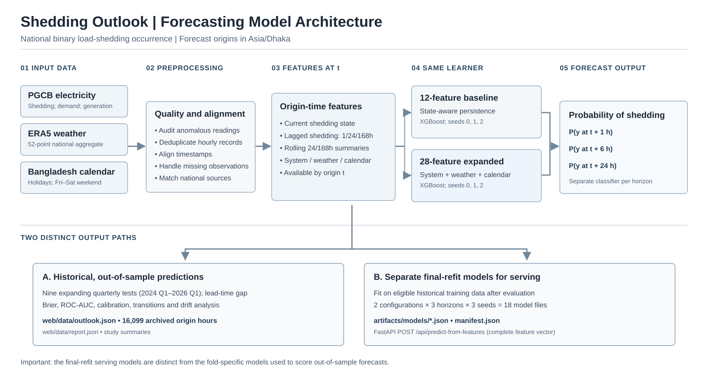

# Shedding Outlook — National Load-Shedding Forecasting in Bangladesh

**Beyond Persistence: When Do System, Weather and Calendar Data Improve Prediction of National Load Shedding in Bangladesh?**

[](https://github.com/J-Rodoshi/shedding-outlook/actions/workflows/ci.yml)


**Shedding Outlook** is the web application and reproducible deployment package developed for an MSc Data Science and Artificial Intelligence course project at the **Asian Institute of Technology**. The research evaluates whether electricity-system, weather, and calendar information adds predictive value *beyond recent load-shedding persistence* when estimating national load-shedding occurrence **1, 6, and 24 hours ahead**.

The repository contains a responsive web app, a FastAPI backend, archived out-of-sample predictions from the research notebook, 18 final-refit XGBoost model files, tests, Docker configuration, and GitHub Actions workflows.

> **Research outcome:** The clearest improvement is at the **6-hour horizon**: a **12.1% relative reduction in Brier score** against a strong state-aware persistence baseline across nine quarterly evaluation periods. The 24-hour improvement is not statistically established in the main comparison.

## Contents

- [Research question and motivation](#research-question-and-motivation)
- [Data sources and prediction target](#data-sources-and-prediction-target)
- [Model architecture and evaluation pipeline](#model-architecture-and-evaluation-pipeline)
- [Models and evaluation design](#models-and-evaluation-design)
- [Main research results](#main-research-results)
- [Application features](#application-features)
- [Repository structure](#repository-structure)
- [Run locally](#run-locally)
- [API reference](#api-reference)
- [Docker and AWS EC2 deployment](#docker-and-aws-ec2-deployment)
- [Rebuild artifacts from the research data](#rebuild-artifacts-from-the-research-data)
- [Reproducibility and interpretation](#reproducibility-and-interpretation)
- [Data attribution and acknowledgements](#data-attribution-and-acknowledgements)

## Research question and motivation

Load shedding is not an independent event from one hour to the next. National shedding records contain long stretches in which the reported shedding state does not change. Consequently, a model can achieve apparently strong performance simply by using the **current shedding condition and recent history**.

This project asks:

> **Do contemporaneous electricity-system, weather, and calendar features improve probabilistic prediction of national load shedding beyond a baseline that already knows the current shedding state?**

The study investigates:

1. Whether richer inputs improve probability forecasts at **1, 6, and 24 hours**.
2. Whether any improvement is concentrated around **shedding onsets and stops**, rather than stable periods.
3. Whether model performance and probability calibration remain reliable as **operating conditions change**.
4. Whether the evaluated research outputs can be packaged into an **accessible, containerized web application**.

The goal is to provide a careful, transparent analysis of **incremental predictive information**, not to report a high classification-accuracy number without a meaningful baseline.

## Data sources and prediction target

Three complementary data sources were integrated in the research notebook:

| Data source | Scope and representative variables | Role |
| --- | --- | --- |
| **PGCB electricity-system records** | 94,934 original records; reported load shedding, demand, generation, fuel mix, India/Nepal interconnections | Binary target and electrical-system predictors |
| **ERA5-derived national weather** | Hourly series aggregated across **52 Bangladesh grid points**; temperature, humidity, precipitation, wind, solar radiation | Weather predictors |
| **Bangladesh calendar** | Hour, weekday, **Friday–Saturday weekend**, public holidays | Temporal and calendar predictors |

The supervised analysis emphasizes the **2022–2026** period, in which positive national shedding was frequently recorded. Cleaning, source auditing, hourly alignment, and feature construction produced **29,448 modelling-ready origin rows**.

For a forecast made at time `t`, the binary target at horizon `h` is:

```text
y(t, h) = 1 if reported national load shedding at t + h is positive
          0 otherwise

h ∈ {1, 6, 24} hours
```

Future labels are matched to the **exact future clock hour** rather than the next available observation. Missing targets are not silently assumed to mean no shedding.

**Geographic interpretation:** These are **national, operator-reported load-shedding outcomes**. They do not predict which neighbourhood, household, or division will lose electricity.

## Model architecture and evaluation pipeline

The following figure describes the **scientific forecasting architecture**, including the data sources, origin-time feature engineering, two controlled XGBoost branches, multi-horizon outputs, and the distinction between evaluation archives and independently saved serving models.



[Open the model architecture as SVG](docs/model_pipeline.svg)

### Pipeline stages

| Stage | Description |
| --- | --- |
| **1 — Integrate data** | Combine PGCB electricity-system readings, national weather, and Bangladesh calendar information. |
| **2 — Clean and align** | Audit inconsistent readings, deduplicate and regularize hourly timestamps, handle documented missing values, and synchronize sources in Bangladesh local time. |
| **3 — Engineer features at origin `t`** | Construct state, lag, rolling, system, weather, and calendar variables without using the future target as an input. |
| **4 — Compare the same learner** | Train separate **12-feature** and **28-feature** XGBoost classifiers for each prediction horizon, with consistent core hyperparameters. |
| **5 — Validate across time** | Use **nine expanding-training quarterly folds** with a horizon-dependent gap and seed averaging. |
| **6 — Evaluate** | Compare Brier score, discrimination, calibration, transitions, quarterly failures, feature contributions, and robustness. |
| **7 — Export two distinct artifact types** | Save archived **out-of-sample fold predictions** for the historical dashboard and separately train **final-refit models** for feature-based API inference. |

### Model specifications

| Configuration | Features | What it tests |
| --- | ---: | --- |
| **State-aware persistence baseline** | 12 | What can already be learned from shedding history, current shedding state, contemporaneous system gap, and hour-of-day indicators? |
| **Expanded XGBoost candidate** | 28 | Do demand/generation, weather, calendar and selected interconnection variables add useful information beyond the baseline? |

The two configurations use **XGBoost classifiers**, so their comparison primarily isolates the added information rather than a change in learning algorithm. The core configuration uses **300 trees**, **maximum depth 6**, **learning rate 0.05**, **row subsampling 0.8**, and **column subsampling 0.8**, with predictions averaged across **seeds 0, 1 and 2**.

Other models and rules, including hard carry-forward, seasonal references, logistic regression, Random Forest, histogram gradient boosting, and a training-only feature drift screen, were studied as supplementary comparisons.

### Chronological evaluation

- **Nine quarterly test folds:** January–March 2024 through January–March 2026.
- **Expanding training period:** Each fold trains on earlier data and evaluates on the following test quarter.
- **Lead-time gap:** Training cutoffs account for the 1-, 6-, or 24-hour target lead.
- **Paired within-horizon comparisons:** Candidate and baseline are scored on the same available forecast origins.
- **Uncertainty:** Headline model-minus-baseline Brier differences use paired **7-day moving-block bootstrap intervals**.
- **Interpretability:** Grouped permutation importance and SHAP are used to describe fitted-model behaviour, not causation.

The three horizons have different eligible scored sample sizes:

| Forecast horizon | Scored origins |
| --- | ---: |
| 1 hour | 16,099 |
| 6 hours | 15,307 |
| 24 hours | 16,059 |

## Main research results

**Primary metric: Brier score (lower is better).** These are the final notebook/report comparison results for the persistence-aware baseline and the **exploratory fixed 28-feature XGBoost** candidate.

| Horizon | Baseline Brier | Expanded-model Brier | Model minus baseline (95% CI) | Interpretation |
| --- | ---: | ---: | --- | --- |
| **1 hour** | 0.0561 | 0.0542 | −0.0019 [−0.0034, −0.0006] | Small improvement (~3.4%) |
| **6 hours** | 0.1400 | **0.1230** | **−0.0170 [−0.0248, −0.0095]** | **Strongest supported improvement (~12.1%)** |
| **24 hours** | 0.1484 | 0.1436 | −0.0047 [−0.0119, +0.0022] | Improvement not established |

A **negative** model-minus-baseline Brier difference favours the expanded model. The 24-hour confidence interval crosses zero.

The **28-feature set was selected after examining evaluation folds**, so its reported benefits must be treated as **exploratory**. A separate *training-only drift-screen* model also improved the 6-hour Brier score (0.1261 versus baseline 0.1400), providing an additional robustness check without claiming independent confirmation of the post-hoc fixed feature set.

### What the diagnostics showed

**State transitions.** At six hours, the richer model improved Brier score from **0.0721 to 0.0638** during stable hours and from **0.4011 to 0.3522** during switching hours. These categories were determined from observed future outcomes **retrospectively**, not through an operational transition detector.

**January–March 2025 failure.** The expanded model performed **worse** than the baseline across all three horizons in this quarter. A substantial shift in the India–Tripura electricity-import feature coincided with the failure. Removing that feature improved six-hour Brier from **0.2076 to approximately 0.1894**, but this still did not outperform the baseline **0.1831**. The evidence supports a distribution-shift hypothesis; it does **not** prove a causal mechanism.

**Calibration.** The main model's pooled calibration slope was approximately **0.97 at 1 hour**, **0.72 at 6 hours**, and **0.67 at 24 hours**. Longer-horizon probability outputs were less reliable, despite useful risk ranking.

**Interpretability.** Shedding history was the most influential feature family. Demand/generation provided additional information; weather and calendar features had smaller contributions. SHAP and permutation importance describe the fitted model's associations, not physical causes.

**Exploratory day-ahead extension.** On **15,692 matched origin hours**, adding target-hour calendar information and archived day-ahead weather forecasts reduced the 24-hour Brier score from **0.1464 to 0.1331**. This is an exploratory analysis on a matched historical sample, not an independently validated operational result.

### Experimental model cost

The following are **single-CPU, last-fold experimental measurements**, not AWS server latency measurements:

| XGBoost configuration | Fit time | Prediction time per 1,000 rows | Saved model size |
| --- | ---: | ---: | ---: |
| 12-feature baseline | 0.31 s | 3.64 ms | ~1,061 kB |
| 28-feature expanded | 0.53 s | 4.30 ms | ~1,164 kB |

## Application features

The **Shedding Outlook** interface is designed to make the research easier to explore without requiring users to understand XGBoost, calibration curves, or Brier scores.

| View | What the user can explore |
| --- | --- |
| **Today** | Select an **archived date and hour**, inspect the recorded national shedding state, view 1-/6-/24-hour prediction categories, and compare against the observed future outcome where available. |
| **Typical** | Explore historical national shedding frequencies by temperature decile, holiday status, and year. |
| **Analyst** | Review the baseline comparison, grouped feature importance, 6-hour quarterly performance, and the January–March 2025 drift explanation. |

The interface has **Low**, **Elevated**, and **High** display levels. Their probability boundaries are **below 0.25**, **0.25 to below 0.60**, and **0.60 or above**, respectively. These are **UI presentation thresholds**, not independently validated public alert categories.

The location selector includes Bangladesh and its eight divisions for a user-friendly interface. **Changing the division does not alter the forecast**, because the study's target is national, not division-specific.

### Two prediction modes — an important distinction

| Mode | How it works | What it means |
| --- | --- | --- |
| **Historical evaluation dashboard** | Reads `web/data/outlook.json`, containing **actual out-of-sample forecasts** from the nine rolling quarterly test periods | Lets users inspect what fold-specific models predicted for evaluated historical hours |
| **Feature-based model inference API** | Loads the 18 separately trained final-refit XGBoost artifacts and computes predictions from a **complete supplied feature vector** | Supports on-demand inference when appropriately engineered inputs are provided |

The app **does not automatically download live PGCB observations or current forecast features**. It also does not retrain the model whenever someone chooses a date. The browser's historical-date selection retrieves the archived research evaluation output.

The exported historical coverage is **2024-01-01 02:00 through 2026-03-08 22:00 (Asia/Dhaka)**.

## Repository structure

```text
shedding-outlook/
├── app/
│   └── main.py                   # FastAPI endpoints and model loading
├── web/
│   ├── index.html                # Responsive Today / Typical / Analyst app
│   ├── static/app.js             # Browser interactions and visualizations
│   └── data/
│       ├── outlook.json          # Archived out-of-sample predictions
│       ├── report.json           # EDA, results, and feature summaries
│       └── export_validation.csv # Artifact evaluation checks
├── artifacts/
│   ├── models/                   # 18 JSON XGBoost models + manifest
│   └── source_provenance.json    # Checksums and export provenance
├── scripts/
│   ├── export_outlook.py         # Recreate predictions and refit models
│   ├── build_report_json.py      # Recreate research result summaries
│   └── check_artifacts.py        # Check real predictions and model files
├── docs/
│   └── model_pipeline.svg       # Scientific architecture diagram
├── tests/
│   └── test_api.py               # API and artifact integrity tests
├── .github/workflows/
│   ├── ci.yml                    # Tests and Docker build
│   └── publish.yml               # Publish image to GHCR
├── Dockerfile
├── requirements-api.txt
├── requirements-dev.txt
├── requirements-train.txt
└── README.md
```

**Raw datasets and the research notebook are not required to run the published application.** They are needed only when regenerating the research artifacts.

## Run locally

### Requirements

- **Python 3.11**.
- Internet access to install Python dependencies.
- Docker Desktop only if you want to test the container locally.

Clone the project and start the API:

```bash
git clone https://github.com/J-Rodoshi/shedding-outlook.git
cd shedding-outlook

python -m pip install -r requirements-dev.txt
python -m pytest -q tests/
python -m uvicorn app.main:app --host 127.0.0.1 --port 8000
```

On Windows, replace `python` with `py -3.11` if that is how Python 3.11 is installed.

Open:

- **Web application:** http://127.0.0.1:8000/
- **Health check:** http://127.0.0.1:8000/health
- **Interactive API documentation:** http://127.0.0.1:8000/docs

The project's automated API suite contains **13 tests**. Check both the test output and the `/health` response before treating a local run as verified.

## API reference

| Method | Route | Description |
| --- | --- | --- |
| `GET` | `/` | Responsive application |
| `GET` | `/health` | Data availability, coverage, and saved-model checks |
| `GET` | `/api/meta` | Available metadata and supported UI locations |
| `GET` | `/api/hour` | Archived out-of-sample result for one historical origin |
| `POST` | `/api/predict-from-features` | Final-refit model inference from a complete engineered feature vector |
| `GET` | `/docs` | Swagger UI documentation |

### Retrieve a historical evaluated forecast

```bash
curl "http://127.0.0.1:8000/api/hour?date=2025-07-15&hour=10&location=bangladesh"
```

The response identifies the requested origin, recorded current shedding state, and probabilities and observed outcomes for eligible 1-, 6-, and 24-hour targets. For an hour without evaluated predictions, the API returns a **404** instead of fabricating a forecast.

### Generate a prediction from supplied features

Use `POST /api/predict-from-features` in the interactive API documentation. The endpoint expects:

```json
{
  "origin": "2026-03-07T10:00",
  "features": {
    "hour": 10
  }
}
```

This example is **intentionally incomplete** and demonstrates input validation: the endpoint returns the required missing-feature names. For actual inference, supply **all 28 engineered inputs** with the types and units used by the notebook. The required feature lists are available in [`artifacts/models/manifest.json`](artifacts/models/manifest.json).

The final-refit endpoint returns probabilities from both baseline and expanded model families for each horizon by averaging predictions from the three saved seeds. It does **not** establish a live input-data connection.

## Docker and AWS EC2 deployment

### Build and test the container locally

The image uses `python:3.11-slim`, installs runtime dependencies, copies the frontend and model artifacts, and starts a **single Uvicorn worker** as a non-root user.

```bash
docker build -t shedding-outlook:local .
docker run -d --name shedding-outlook-local -p 8002:8000 shedding-outlook:local

curl http://127.0.0.1:8002/health

docker logs shedding-outlook-local
docker rm -f shedding-outlook-local
```

Port `8002` is the example host port; the application listens on port `8000` inside the container.

### GitHub checks and container image

The repository's GitHub Actions **CI** checks run the Python tests and verify that the Docker image builds.

A separately triggered container publishing workflow builds the image and publishes it to **GitHub Container Registry** (GHCR):

```text
ghcr.io/j-rodoshi/shedding-outlook:latest
ghcr.io/j-rodoshi/shedding-outlook:<commit-sha>
```

The commit-specific tag allows a published image to be traced to a particular source revision.

### AWS EC2 implementation

The application was demonstrated on **AWS Academy Learner Lab**, using:

| Resource | Configuration |
| --- | --- |
| AWS region | `us-east-1` (N. Virginia) |
| Instance | `t3.small` |
| Operating system | Amazon Linux 2023 |
| CPU | 2 vCPUs |
| Memory | 2 GiB |
| EBS storage | 20 GiB gp3 |
| Serving process | FastAPI + Uvicorn, one worker |
| HTTP mapping | Host port **80** → container port **8000** |

On an Amazon Linux 2023 instance, Docker can be installed and enabled using:

```bash
sudo dnf install -y docker
sudo systemctl enable --now docker
sudo usermod -aG docker ec2-user
```

After signing out and reconnecting so group membership applies, verify Docker with `docker run --rm hello-world`.

To launch a **publicly accessible** GHCR image on EC2:

```bash
docker pull ghcr.io/j-rodoshi/shedding-outlook:latest

docker run -d \
  --name shedding-outlook \
  --restart unless-stopped \
  --memory 1500m \
  -p 80:8000 \
  ghcr.io/j-rodoshi/shedding-outlook:latest

curl -fsS http://localhost/health
```

The application can then be reached through the instance's public HTTP address if the security group permits inbound **TCP 80**. SSH (**TCP 22**) should be restricted to authorized administrative IP addresses; store the EC2 private key securely and **never commit it**.

The EC2 deployment was verified through the browser, the `/health` endpoint, Docker execution, and accessible FastAPI documentation. Public addresses and machine availability can change in AWS Academy Learner Lab.

## Rebuild artifacts from the research data

The packaged application runs from exported artifacts. Rebuilding them requires the corresponding research notebook outputs to be available **outside this GitHub repository**.

Expected source material includes:

- `modeling_ready.parquet`
- `checkpoint_7_regularized.parquet`
- `results/final_summary.csv`
- `results/fold_summary.csv`
- Other notebook-generated summary CSVs needed by the report exporter

Install training dependencies and regenerate the historical predictions, final-refit models, and report summaries:

```bash
python -m pip install -r requirements-train.txt

python scripts/export_outlook.py \
  --data "/path/to/CP Electricity Project" \
  --out web/data/outlook.json \
  --models artifacts/models

python scripts/build_report_json.py \
  --data "/path/to/CP Electricity Project" \
  --out web/data/report.json

python scripts/check_artifacts.py
python -m pytest -q tests/
```

The exporter follows the nine-quarter evaluation design, trains the two feature configurations at three lead times with three random seeds, and separately refits serving models. When `results/final_summary.csv` is available, it checks its exported Brier scores against the original notebook's saved results, allowing up to **0.001** absolute difference for minor environment differences.

The exported application data is **not synthetic**. Missing required data or features cause validation to fail rather than silently generating substitute forecasts.

## Reproducibility and interpretation

Please preserve these distinctions when using or extending the project:

1. **Target:** The study predicts binary *national operator-reported shedding occurrence*, not the geographical location, duration, or magnitude of household interruptions.
2. **Data timing:** The historical archive ends on **8 March 2026**. The app does not automatically fetch live measurements or weather forecasts.
3. **Historical evaluation versus serving:** Archived out-of-sample predictions came from **fold-specific** models. The 18 final-refit models are separate artifacts for feature-based inference.
4. **Exploratory selection:** The fixed 28-feature model was selected after reviewing evaluation folds, and its headline improvement is therefore exploratory. Training-only alternatives support, but do not eliminate all uncertainty around, the six-hour finding.
5. **Probability quality:** Better Brier score and discrimination do not ensure calibrated probabilities under changing regimes. Presentation risk categories are not operationally validated alerts.
6. **Distribution shift:** The January–March 2025 failure and India–Tripura ablation are diagnostic evidence, not proof of a causal effect.
7. **Runtime cost:** Reported XGBoost model timings are experimental measurements, **not end-to-end AWS latency or cloud-cost estimates**.
8. **Research use:** Comparisons with published demand-forecasting or shedding-magnitude studies are qualitative because their outcome definitions and evaluation protocols differ.

## Data attribution and acknowledgements

This repository is part of the final course project **“Beyond Persistence: When Do System, Weather and Calendar Data Improve Prediction of National Load Shedding in Bangladesh?”**, prepared by **Jarin Tasnim Rodoshi and Khaing Mon Kyaw**, **Asian Institute of Technology**, November 2026.

Data and methodological sources include:

- **PGCB-derived hourly dataset:** [Hourly Electricity Generation, Demand, Load Shedding, and Fuel Mix Dataset for Bangladesh (2015–2026), Mendeley Data](https://data.mendeley.com/datasets/vpk8spw2mm/1).
- **ERA5 / ERA5-Land:** [ERA5 reanalysis](https://www.ecmwf.int/en/forecasts/dataset/ecmwf-reanalysis-v5), used for the prepared research weather variables.
- **Bangladesh calendars:** [Python `holidays` package](https://pypi.org/project/holidays/).
- **Forecasting algorithm:** [XGBoost](https://xgboost.readthedocs.io/).
- **Explainability method:** [SHAP](https://shap.readthedocs.io/).

The copyright, citation and distribution obligations for upstream datasets remain with their original providers. The source code and model outputs are shared for research and educational demonstration; they do not constitute an operational electricity-outage warning service.
